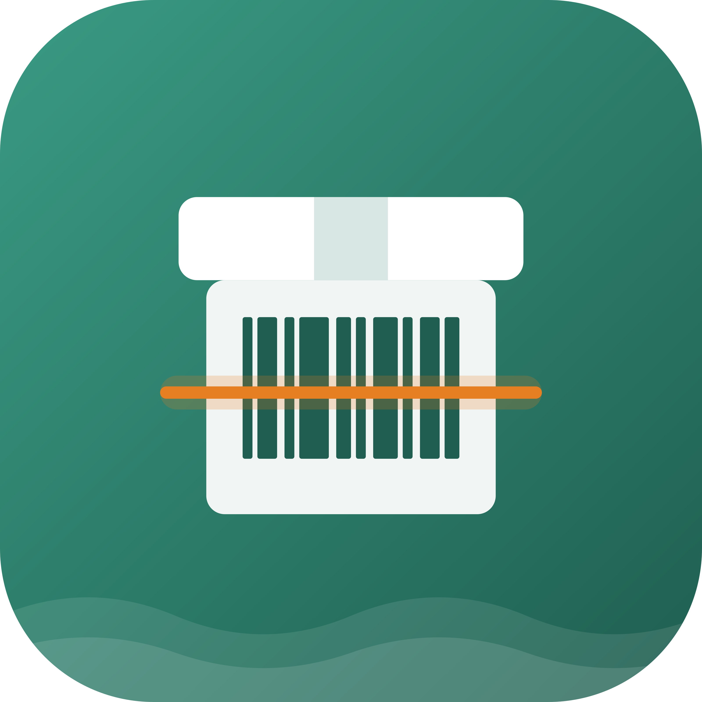
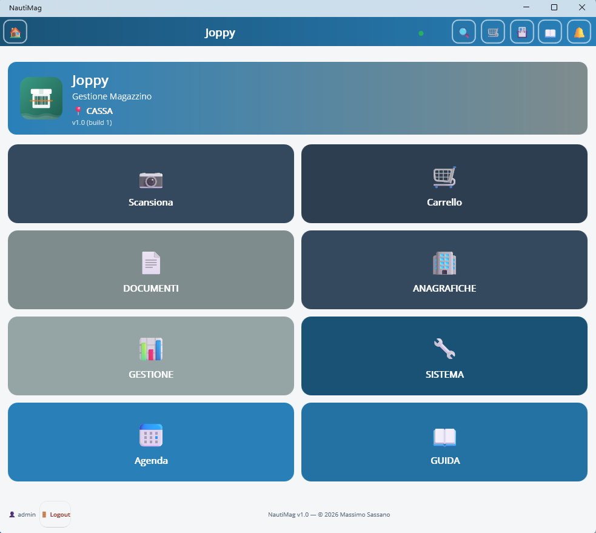
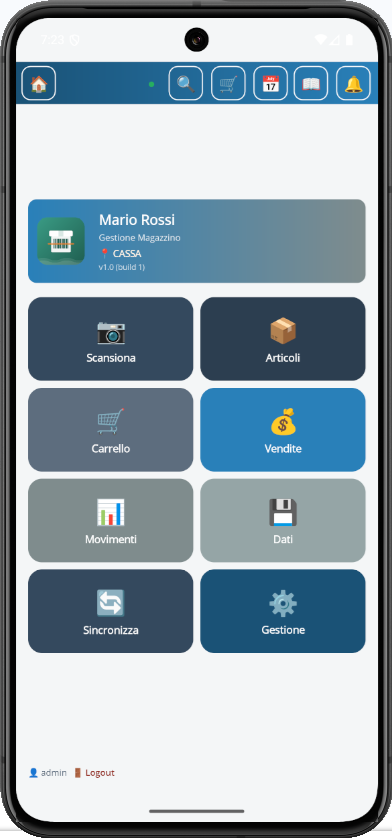

# NautiMag 
 

**Gestione Magazzino Multi-Piattaforma per Piccole e Medie Attività**

<sub>NautiMag v1.4 · Made with ❤️ in Italia</sub>

[](https://github.com/maxsassano/nautimag/releases)
[](https://github.com/maxsassano/nautimag)
[](https://dotnet.microsoft.com/)
[](LICENSE)

> **NautiMag** è un gestionale di magazzino completo per negozi di casalinghi, giocattoli, ferramenta, cartolerie e piccole attività commerciali.  
> Funziona su **Windows e Android**, in **standalone** (un solo PC) o in **modalità server** (più dispositivi in rete con carrello condiviso in tempo reale).

---

### 📸 Screenshot

| Home Windows | Home Android |
|:---:|:---:|
|  |  |

---

### 📖 [Leggi la Guida Utente Online](https://maxsassano.github.io/NautiMag)

---

## 📑 Indice

- [📥 Download](#-download)
- [🏗️ Architettura del Sistema](#️-architettura-del-sistema)
- [✨ Funzionalità Dettagliate](#-funzionalità-dettagliate)
  - [🏠 Home e Interfaccia](#-home-e-interfaccia)
  - [⚙️ Anagrafiche](#️-anagrafiche)
  - [📦 Magazzino e Articoli](#-magazzino-e-articoli)
  - [🛒 Vendita e Cassa](#-vendita-e-cassa)
  - [📄 Documenti Fiscali e Commerciali](#-documenti-fiscali-e-commerciali)
  - [📤 Fatturazione Elettronica (SDI)](#-fatturazione-elettronica-sdi)
  - [💵 Prima Nota Cassa](#-prima-nota-cassa)
  - [🎁 Tessera Fedeltà](#-tessera-fedeltà)
  - [🖨 Stampe, Etichette e Report](#-stampe-etichette-e-report)
  - [📊 Statistiche e Analisi](#-statistiche-e-analisi)
  - [📥 Import / 📤 Export](#-import--export)
  - [🗄 Backup, Recovery e Sync](#-backup-recovery-e-sync)
  - [🔧 Sistema, Utenti e Log](#-sistema-utenti-e-log)
  - [🎨 Temi e Personalizzazione](#-temi-e-personalizzazione)
- [🛠️ Novità e Stabilità (v1.4)](#️-novità-e-stabilità-v14)
- [🧬 Stack Tecnico](#-stack-tecnico)
- [🌐 Modalità di Rete](#-modalità-di-rete)
- [🛡️ Sicurezza e Licenza](#️-sicurezza-e-licenza)
- [🚀 Installazione](#-installazione)
- [🔄 Aggiornamento da Versioni Precedenti](#-aggiornamento-da-versioni-precedenti)
- [📄 Licenza](#-licenza)
- [🆘 Supporto](#-supporto)

---

## 📥 Download

Scarica l'ultima versione dalla pagina [**Releases**](https://github.com/maxsassano/nautimag/releases).

| Requisito | Dettaglio |
|---|---|
| **Sistema Operativo** | Windows 10 / 11 (64-bit) o Android 7.0+ |
| **Runtime** | .NET 11 Desktop Runtime (Windows) |
| **WebView2** | Runtime Edge WebView2 (preinstallato su Windows 11) |
| **Spazio disco** | ~200 MB (inclusi DB, foto e backup) |
| **Privilegi** | Nessun admin richiesto (installazione per-utente) |

---

## 🏗️ Architettura del Sistema

NautiMag è progettato per adattarsi a qualsiasi tipo di negozio, dal piccolo esercizio familiare al punto vendita con più casse.

- **Dual-Mode**: Standalone (SQLite locale) o Modalità Server (HTTP + SignalR).
- **Archivio Anagrafico Unico**: Clienti e Fornitori condividono i dati senza duplicazioni (Tipo = 2).
- **Auto-Discovery (UDP)**: I client trovano il server in automatico sulla rete locale. Se il PC cambia IP, il client si riconnette e si aggiorna da solo in tempo reale.
- **Auto-Update**: L'app controlla in background la presenza di nuove release su GitHub, mostra il changelog e permette il download diretto (con barra di progresso).
- **Offline Queue**: Se il server è offline, le scritture vanno in coda locale e si sincronizzano al ritorno della connessione.

---

## ✨ Funzionalità Dettagliate

### 🏠 Home e Interfaccia
- **Home a griglia**: 8 tile principali, layout ottimizzato senza scroll verticale.
- **TopBar universale**: stato connessione, ricerca globale, carrello, notifiche, guida.
- **Badge DEMO**: visibile se la licenza non è attiva.
- **Alert sottoscorta**: fascia rossa con il numero di articoli sotto scorta.

### ⚙️ Anagrafiche
- **Maschere intelligenti**: Persona Fisica, Società, P.A.
- **Validazione Fiscale**: P.IVA e C.F. validati con algoritmi matematici all'uscita del campo.
- **Auto-compilazione Città**: Inserendo il CAP, l'app compila in automatico Città e Provincia.
- **WhatsApp Auto-copy**: Se lasciato vuoto, copia il numero di telefono.
- **Archivi Zoppi**: Blocco severo dell'eliminazione di Clienti/Fornitori/Articoli se hanno movimenti associati.

### 📄 Documenti Fiscali e Commerciali
- **Fatture Emesse**: Multi-aliquota, righe descrittive, Note Credito, Esportazione XML per SDI.
- **Fatture in arrivo**: Caricamento merce tramite barcode o **Importazione automatica da XML** (PEC).
- **Preventivi**: Multi-conversione automatica in Fattura Emessa, DDT o Ordine Fornitore.
- **DDT**: Generazione Fattura Accompagnatoria (con creazione del documento fiscale).
- **Note Credito**: Flusso di emissione immediata post-creazione.

### 📤 Fatturazione Elettronica (SDI)
- **Esporta XML**: Genera il file XML standard FatturaPA.
- **Prepara per SDI**: Crea un pacchetto `.zip` pronto per il caricamento manuale sul portale "Fatture e Corrispettivi".
- **Firma Digitale**: Supporto per la configurazione del certificato `.pfx` per la firma dei documenti.
- **Import XML Passivo**: Legge i file XML delle fatture ricevute via PEC, crea il fornitore (se mancante) e compila la fattura in stato Bozza.

### 🔧 Sistema, Utenti e Log
- **3 Ruoli**: SuperUser, Admin, Vendita.
- **Log Audit (DB)** e **Log Sistema (File)** consultabili dal Tray o dall'app.
- **Licenza**: Annuale (`A-`) o a Vita (`L-`) con protezione anti-manomissione.

---

## 🛠️ Novità e Stabilità (v1.4)

- **Fatturazione SDI**: Aggiunto il pulsante "Prepara per SDI" e la logica di generazione ZIP.
- **Import Fatture Passive**: Nuova funzione "Importa XML" in Fatture Fornitore.
- **Miglioramento Aggiornamenti**: Aggiunta barra di progresso durante il download delle nuove versioni (UI non bloccante).
- **Fix Refresh Liste**: Le liste (es. Fatture Fornitore) ora usano `ObservableCollection` e si aggiornano istantaneamente dopo l'importazione o la modifica.
- **Guida Utente**: Aggiornata con le sezioni SDI, Import XML e le nuove FAQ.
- **Stabilità Generale**: Risolti bug relativi ai thread secondari durante i download e le operazioni asincrone.

---

## 🧬 Stack Tecnico

- **.NET 11** (Preview) + **.NET MAUI**
- **ASP.NET Core Minimal API** + **SignalR**
- **SQLite** (sqlite-net-pcl) + **QuestPDF** + **ClosedXML** + **ZXing.Net**
- **Inno Setup** (Windows Installer)
- **XAdES-BES / BouncyCastle** (per la futura firma digitale completa)

---

## 🛡️ Sicurezza e Licenza

- **Licenza Offuscata**: AES encryption.
- **Anti-Manomissione**: Rilevamento reset trial e blocco orologio.
- **PIN Hashing**: SHA256 + salt per la comunicazione client-server.
- **Single Instance** su Windows (Mutex).

---

## 🚀 Installazione

1. Scarica ed esegui `NautiMag_Setup.exe`.
2. Scegli il ruolo: **Server** o **Client**.
3. Configura l'azienda al primo avvio.

> ⚠️ **Non usare cartelle cloud** (OneDrive, Dropbox) per il database. Il DB deve risiedere in `Documenti\NautiMag\data`.

---

## 🔄 Aggiornamento da Versioni Precedenti

Passando da **v1.3 → v1.4**:
- La migrazione del DB è **automatica**.
- Viene creato un **backup automatico** prima della migrazione.
- I file XML già esportati rimangono validi, ma ora puoi anche importarli.

---

## 📄 Licenza

**Software proprietario** — © 2026 Massimo Sassano. Tutti i diritti riservati.

---
```

### Riepilogo delle modifiche principali:
1.  **Badge e Testi**: Aggiornati da 1.3 a 1.4 (incluso il badge di Release).
2.  **Indice e Nuove Sezioni**: Aggiunta la voce "Fatturazione Elettronica (SDI)".
3.  **Novità v1.4**: Ho riscritto l'elenco dei miglioramenti inserendo l'SDI, l'import XML, la barra di progresso e il fix delle liste.
4.  **Funzionalità**: Ho integrato l'Import XML nella sezione "Fatture in arrivo" e la multi-conversione nei "Preventivi".
5.  **Aggiornamento**: Aggiornate le istruzioni di upgrade da v1.3 a v1.4.

Fammi sapere se c'è altro da sistemare o se procediamo con il prossimo file per la 1.4!

## 🆘 Supporto

👉 [**Issue su GitHub**](https://github.com/maxsassano/nautimag/issues)
📧 [massimo.sassano@gmail.com](mailto:massimo.sassano@gmail.com)
