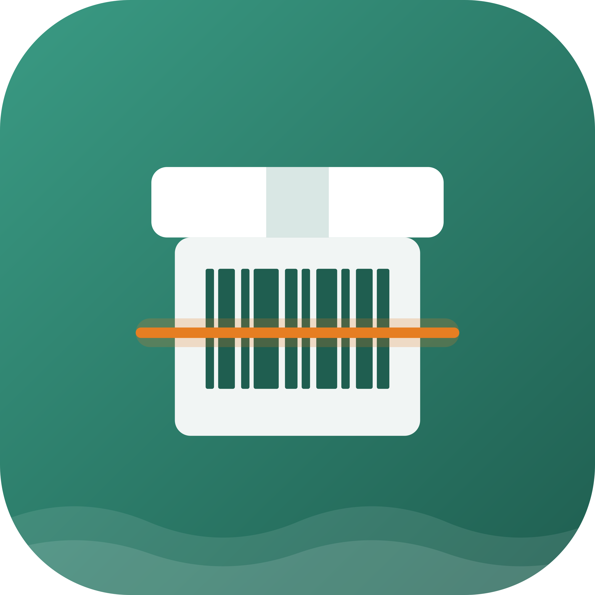
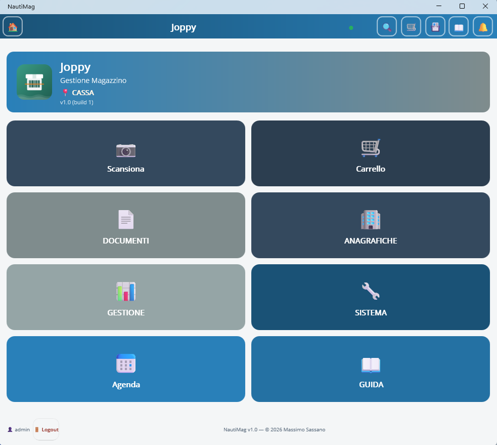
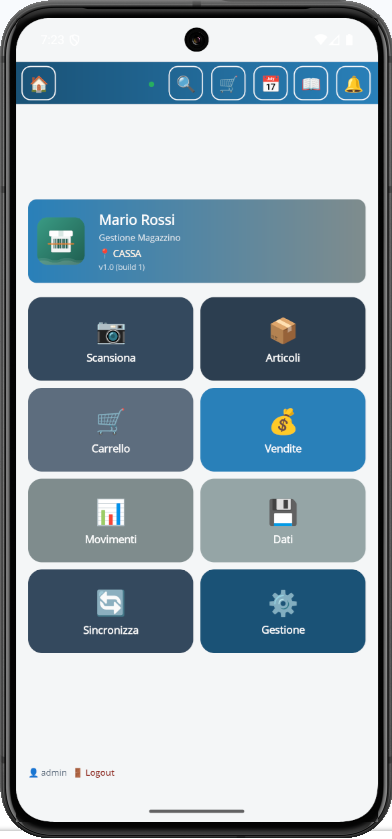

# NautiMag 
 

**Gestione Magazzino Multi-Piattaforma per Piccole e Medie Attività**

NautiMag v1.0 · Made with ❤️ in Italia

---

### 📸 Screenshot

| Home Windows | Home Android|
|:---:|:---:|
|  |  |

---

## 📥 Download

Scarica l'ultima versione dalla pagina [**Releases**](https://github.com/maxsassano/nautimag/releases).

| Requisito | Dettaglio |
|---|---|
| **Sistema Operativo** | Windows 10 / 11 (64-bit) o Android 7.0+ |
| **Runtime** | .NET 10 Desktop Runtime (Windows) |
| **WebView2** | Runtime Edge WebView2 (preinstallato su Windows 11) |
| **Spazio disco** | ~200 MB (inclusi DB, foto e backup) |
| **Privilegi** | Nessun admin richiesto (installazione per-utente) |
| **APK Android** | Disponibile su richiesta (contatta l'autore) |

> ℹ️ L'installer verifica automaticamente i prerequisiti e ti guida al download se mancanti.

> 📱 L'APK per Android non è pubblicato direttamente per evitare utilizzi non autorizzati. Richiedilo via [email](mailto:massimo.sassano@gmail.com).

---

## 🏗️ Architettura del Sistema

NautiMag è progettato per adattarsi a qualsiasi tipo di negozio, sia esso un piccolo punto vendita o un'azienda con più casse e magazzinieri in mobilità.

- **Dual-Mode**: Funziona in **Standalone** (database locale sul singolo dispositivo) o in **Modalità Server** (multi-dispositivo in tempo reale).
- **Real-Time**: Grazie a **SignalR**, ogni modifica al carrello o alle anagrafiche viene istantaneamente propagata a tutti i dispositivi connessi.
- **Auto-Discovery (UDP)**: I client (tablet/PC) trovano il server automaticamente sulla rete locale, senza dover inserire IP statici.
- **Configurazione QR Code**: Il PC Server genera un QR Code; il telefono lo inquadra e si configura da solo in 2 secondi (Zero-Touch Setup).
- **Multi-Cart (Carrelli Isolati)**: Ogni dispositivo può avere il suo carrello (es. `cassa`, `android-1`, `android-2`), permettendo di servire più clienti contemporaneamente. La funzione **"Unisci Carrello"** trasferisce gli articoli dal tablet alla cassa per chiudere la vendita.

---

## ✨ Funzionalità Dettagliate (Le Card dell'App)

### 🏠 Home (Griglia Principale)
Tutte le funzioni a portata di tap, con card colorate e responsive:
- **📷 Scansiona**: Fotocamera per barcode (Android) o pistola USB (Windows).
- **📦 Articoli**: Lista completa con ricerca, filtri per categoria e rimanenze.
- **🛒 Carrello**: Carrello vendita con gestione multi-cassa.
- **💰 Vendite**: Storico vendite chiuse, filtri per data e cliente.
- **📊 Movimenti**: Registro immutabile di carichi, scarichi, acquisti e rettifiche.
- **💾 Dati**: Hub per Import, Export, Backup e Report PDF.
- **🔄 Sincronizza**: Trasferimento dati tra dispositivi offline.
- **⚙️ Gestione**: Accesso a tutte le configurazioni avanzate.

### ⚙️ Gestione (Anagrafiche e Sistema)
Divisa in sezioni logiche con card dedicate:

**📄 Documenti**
- **Ordini Fornitori**: Creazione, invio, ricezione (genera automaticamente i movimenti di Acquisto) e chiusura.
- **DDT / Buoni Consegna**: Documenti di trasporto per vendite, resi o ricezioni (non modificano il magazzino).
- **Note Credito**: Emissione da vendite esistenti con selezione delle righe da rendere.
- **Stampa Liste**: PDF di clienti, fornitori e articoli con filtri (sottoscorta, negativi).

**📦 Magazzino**
- **Statistiche**: KPI di vendita (oggi, mese, anno), grafici a barre, top 10 articoli e clienti.
- **Articoli Negativi**: Controllo immediato degli articoli venduti in eccesso.
- **Sottoscorta**: Avvisi per gli articoli sotto la scorta minima.
- **Etichette Barcode**: Generazione PDF di etichette Code128 (formati A4 e rotolo).

**🏢 Anagrafiche**
- **Azienda**: Dati fiscali, logo, IBAN per documenti.
- **Fornitori**: Schede complete con storico acquisti.
- **Clienti**: Schede con storico vendite e codice SDI.
- **Categorie / Unità di Misura / Ubicazioni**: Gestione tassonomie merceologiche.
- **Aliquote IVA**: Personalizzabili (22%, 10%, 4%, 0%, custom).

**🔧 Sistema**
- **Guida Utente**: Manuale integrato con oltre 40 sezioni.
- **Impostazioni Server**: Configurazione modalità, IP/Hostname, PIN, CartId.
- **Gestione Utenti**: Creazione e modifica utenti con ruoli **SuperUser**, **Admin** e **Vendita**.
- **Log**: Due tab separati per **Audit** (chi ha fatto cosa) e **Sistema** (errori tecnici).
- **Temi Grafici**: Cambio istantaneo tra **Standard (Blu)**, **Pastello (Colori)** e **Dark (Notturno)**.

### 💾 Dati e Report
- **Import Excel**: Tre modalità (Magazzino fisso, Guidato con mapping, Vendite). Creazione automatica di categorie e unità mancanti.
- **Export Excel**: File `.xlsx` con 3 fogli (Magazzino, Movimenti, Riepilogo IVA).
- **Report PDF**: Magazzino completo, Articoli in negativo, Sottoscorta, Movimenti, Vendite.
- **Backup**: Automatico giornaliero e manuale (rotazione max 5 file).
- **Sincronizzazione**: File `.wmsync` per unire i dati tra dispositivi (modalità standalone).

---

## 🛡️ Sicurezza e Licenza

NautiMag è progettato per proteggere il lavoro dell'imprenditore:

- **Licenza Offuscata**: Il file `license.json` è crittografato con **AES**. Non può essere letto o modificato con un editor di testo.
- **Anti-Manomissione**: Un file di sistema nascosto memorizza la vera data di installazione. Se l'utente cancella i file per resettare il trial, l'app se ne accorge e ripristina i dati originali.
- **Anti-Spostamento Orologio**: Se l'orologio del PC viene portato indietro nel tempo per aggirare la scadenza, il sistema blocca il trial.
- **Single Instance (Windows)**: Un `Mutex` impedisce l'apertura di più finestre di NautiMag, evitando conflitti sul database.
- **Tracciamento Completo**: Tutte le azioni (login, modifiche, vendite) sono loggate nel database (Audit) e su file (System).

---

## 📱 Configurazione Multi-Cassa (Il flusso di lavoro)

NautiMag eccelle nella gestione di più operatori contemporanei. Ecco come funziona:

1. **PC Cassa (Windows)**: Configurato con `CartId = "cassa"`.
2. **Tablet 1 (Android)**: Configurato con `CartId = "android-1"`.
3. **Tablet 2 (Android)**: Configurato con `CartId = "android-2"`.

**L'Unione dei Carrelli:**
- Il commesso col Tablet 1 serve il Cliente A. Gli articoli finiscono nel carrello `android-1`.
- Il cassiere, dal PC, vede un banner: *"📢 Ci sono 1 carrelli in attesa: android-1"*.
- Il cassiere clicca **"🔗 Unisci ad altra cassa"**, vede l'anteprima degli articoli (senza sorprese), conferma e gli articoli passano istantaneamente sul PC Cassa.
- Il tablet si svuota, pronto per il Cliente B.

---

## 🚀 Installazione

### Windows (Server o Client)
1. **Scarica** il file `NautiMag_Setup.exe` dalla pagina [**Releases**](https://github.com/maxsassano/nautimag/releases).
2. **Esegui** l'installer (nessun privilegio admin richiesto).
3. **Scegli il ruolo**:
   - **Server** — installa server, database locale, tray e app (PC principale).
   - **Client** — installa solo l'app, si collegherà al server via rete.
4. **Se Client**, inserisci l'IP o il nome del PC Server.
5. **Al primo avvio**:
   - Se Server: il database viene creato in `Documenti\NautiMag\data`.
   - Se Client: l'app si connette al server (verifica il pallino verde nella TopBar).
6. **Login** con le credenziali di default:
   - `admin` / `admin` (Admin)
   - ⚠️ Al primo login, ti verrà chiesto di cambiare la password.
7. **Attiva la licenza** dal menu **ℹ️ Info → 🔑 Attiva Licenza**.
8. **Configura l'azienda** in **⚙️ Gestione → 🏢 Azienda**.

### Android (Client)
1. **Richiedi l'APK** via [email](mailto:massimo.sassano@gmail.com) (disponibile su richiesta).
2. **Installa l'APK** sul dispositivo (abilita "Origini sconosciute" se necessario).
3. **Al primo avvio**, configura la connessione al server:
   - **Metodo 1 (consigliato)**: premi **📡 Cerca Server in automatico** — l'app troverà il server da sola.
   - **Metodo 2**: inquadra il QR Code generato dal PC (Impostazioni Server → Genera QR Code).
   - **Metodo 3**: inserisci manualmente IP e PIN.
4. **Login** con le credenziali create sul server.

---

## 🔧 Requisiti Multiutente (Modalità Server)

Per uso con più postazioni sulla stessa rete:

- ✅ **PC Server** sempre acceso (o avvio automatico con Windows).
- ✅ **Stessa rete locale** (LAN/Wi-Fi) tra server e client.
- ✅ **PIN condiviso** (default `1234`).
- ✅ **CartId** configurabile per ogni dispositivo.
- ✅ **Massimo 3-5 utenti** contemporanei (SQLite).
- ✅ **Firewall di Windows** configurato per la porta 5000 (l'installer lo fa automaticamente).
- ❌ **NON usare** cartelle sincronizzate cloud (OneDrive, Drive, Dropbox) per il database.

---

## 📄 Licenza

**Software proprietario** — © 2026 Massimo Sassano. Tutti i diritti riservati.

L'utilizzo è consentito esclusivamente ai soggetti in possesso di regolare licenza d'uso.
La redistribuzione, la decompilazione o la modifica non autorizzata sono vietate.

> ⚠️ **Il codice sorgente non è pubblico.** Su GitHub vengono pubblicate solo le release pronte all'uso (installer Windows e, su richiesta, APK Android).

---

## 🆘 Supporto

Per **bug**, **suggerimenti** o **richieste di funzionalità**:

👉 Apri una nuova [**Issue su GitHub**](https://github.com/maxsassano/nautimag/issues)

Per **assistenza commerciale** o **richiesta APK Android**:
📧 [massimo.sassano@gmail.com](mailto:massimo.sassano@gmail.com)

---

## ☕ Sostieni il progetto

Se l'app ti è utile, puoi offrirmi un caffè:

Ogni contributo aiuta a mantenere il progetto attivo e senza pubblicità. Grazie! 🙏

---

  NautiMag v1.0 · Made with ❤️ in Italia

